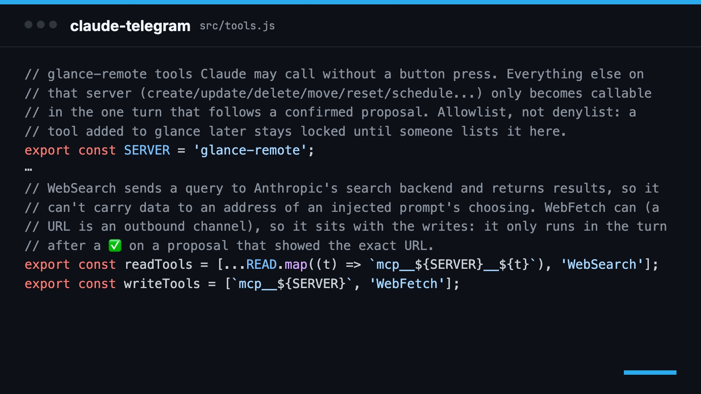
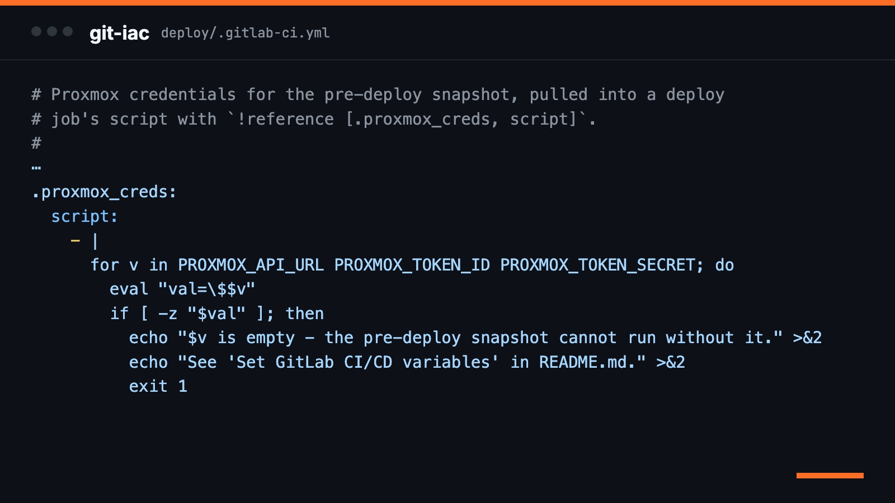
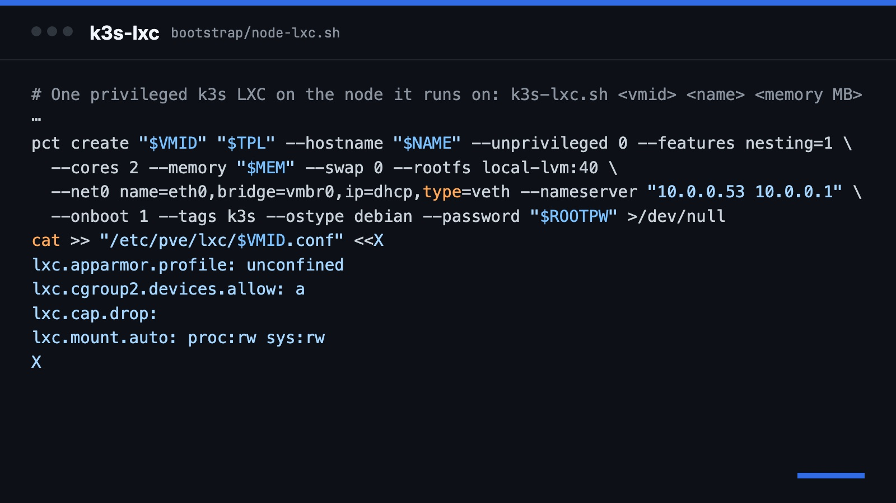
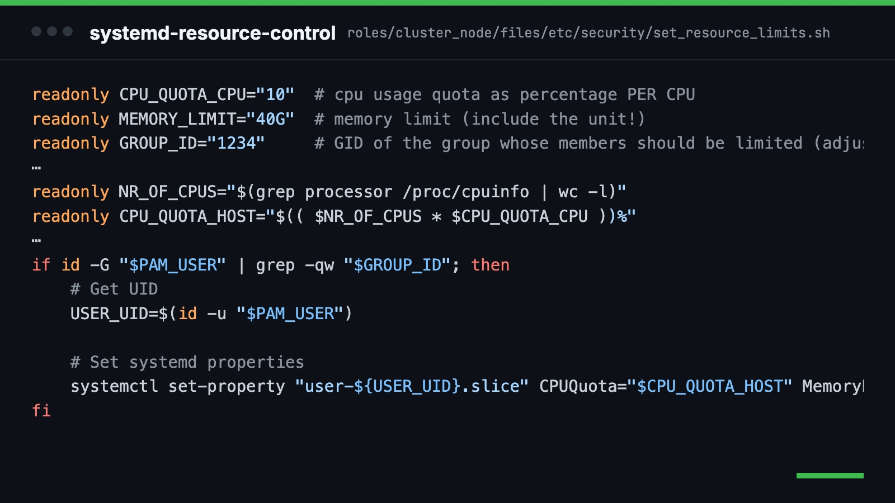

# Johannes Nguyen

IT Specialist for System Integration (IHK) at the German Cancer Research Center (DKFZ) in Heidelberg.
I run Linux, Ansible and Kubernetes for research infrastructure, from the HPC cluster to the datacenter rack,
and build my own tools on the side.

[j551n.com](https://j551n.com) · [Blog](https://blog.j551n.com) · [LinkedIn](https://www.linkedin.com/in/johannesquangminh) · [johannes.nguyen@j551n.com](mailto:johannes.nguyen@j551n.com)

## Projects

<table>
<tr>
<td colspan="2" valign="top">

<a href="https://github.com/j551n-ncloud/edge-ciq"><b>edge-ciq</b></a> Connect IQ apps for my Garmin Edge 1030 Plus: a ride page with heart rate zones and gel alerts by route length and zone, a Spotify remote straight to the Web API, and a pre-ride brief from glance.

</td>
</tr>
<tr>
<td width="50%" valign="top">

<a href="https://github.com/j551n-ncloud/glance-public"><b>glance-public</b></a> Dashboard and assistant backend with a remote MCP server: calendar, tasks, notes with hybrid RAG search, training. <a href="https://blog.j551n.com/from-dashboard-to-assistant-backend-glance-with-73-mcp-tools/">Blog</a>

</td>
<td width="50%" valign="top">

<a href="https://github.com/j551n-ncloud/claude-telegram"><b>claude-telegram</b></a> Claude Code over Telegram: voice notes in, reads by default, every write behind a confirm button. <a href="https://blog.j551n.com/claude-code-in-telegram-voice-notes-in-every-write-behind-a-button/">Blog</a>

</td>
</tr>
<tr>
<td width="50%" valign="top">

<a href="https://github.com/j551n-ncloud/git-iac"><b>git-iac</b></a> Self-hosted GitOps: separate build and deploy pipelines, Harbor with Trivy, Proxmox snapshot before every deploy. <a href="https://blog.j551n.com/two-repos-one-pipeline-self-hosted-gitops-with-gitlab-ci-harbor-and-ansible/">Blog</a>

</td>
<td width="50%" valign="top">

<a href="https://github.com/j551n-ncloud/k3s-lxc"><b>k3s-lxc</b></a> HA k3s in Proxmox LXC containers: GitLab runners on Kubernetes and a LAN proxy with Traefik, kube-vip and cert-manager. <a href="https://blog.j551n.com/one-dead-psu-one-bad-ram-stick-rebuilding-my-proxmox-cluster-in-a-night/">Blog</a>

</td>
</tr>
<tr>
<td width="50%" valign="top">

<a href="https://github.com/j551n-ncloud/systemd-resource-control"><b>systemd-resource-control</b></a> Ansible role for per-user CPU and RAM limits via systemd slices and PAM, in production on an HPC cluster. <a href="https://blog.j551n.com/per-user-cpu-and-ram-limits-on-shared-cluster-nodes-with-systemd-and-pam/">Blog</a>

</td>
<td width="50%" valign="top">

<a href="https://github.com/j551n-ncloud/calendar-dash"><b>calendar-dash</b></a> Calendar dashboard and tablet display for any CalDAV server, inspired by spacepad.io: free or busy at a glance, the next event with a countdown. <a href="https://blog.j551n.com/a-spare-tablet-as-a-room-display-a-small-caldav-dashboard/">Blog</a>

</td>
</tr>
</table>

### More MCP servers

| Server | Connects Claude to | Good to know |
|---|---|---|
| [ghost-mcp](https://github.com/j551n-ncloud/ghost-mcp) | Ghost Admin API: search and read posts, write drafts, upload images | Publishing stays manual |
| [navidrome-mcp](https://github.com/j551n-ncloud/navidrome-mcp) | Navidrome: duplicate songs, broken and doubled playlists, scans, plugins | Dry run by default, backup before every change |
| [tft-mcp](https://github.com/j551n-ncloud/tft-mcp) | Teamfight Tactics: live meta comps, items, augments, pro positioning, coaching | No API keys needed |
| [blok-berichtsheft-mcp](https://github.com/j551n-ncloud/blok-berichtsheft-mcp) | BLok Ausbildungsnachweis, filled out through Playwright | Works without an API, since BLok has none |

## Skills

**Linux & HPC** · RHEL, Debian, systemd, IBM LSF, IBM ESS, Dell iDRAC 
**Automation** · Ansible, AWX, GitLab CI/CD, GitHub Actions, Kickstart 
**Containers & virtualization** · Kubernetes (k3s, Helm), Docker, Harbor, Proxmox VE and PBS, VMware ESXi 
**Identity & security** · LDAP/AD, ADFS, OIDC/SSO, CrowdSec, Trivy 
**Observability** · Loki, Grafana Alloy, Grafana, Prometheus, Checkmk 
**Development & AI** · Python, TypeScript, Node.js, RAG, MCP

Self-hosted: [GitLab](https://gitlab.j551n.com) · [Docs](https://docu.j551n.com)

<picture>
  <source media="(prefers-color-scheme: dark)" srcset="https://raw.githubusercontent.com/j551n-ncloud/j551n-ncloud/output/github-snake-dark.svg" />
  <source media="(prefers-color-scheme: light)" srcset="https://raw.githubusercontent.com/j551n-ncloud/j551n-ncloud/refs/heads/output/github-snake.svg" />
  
</picture>
